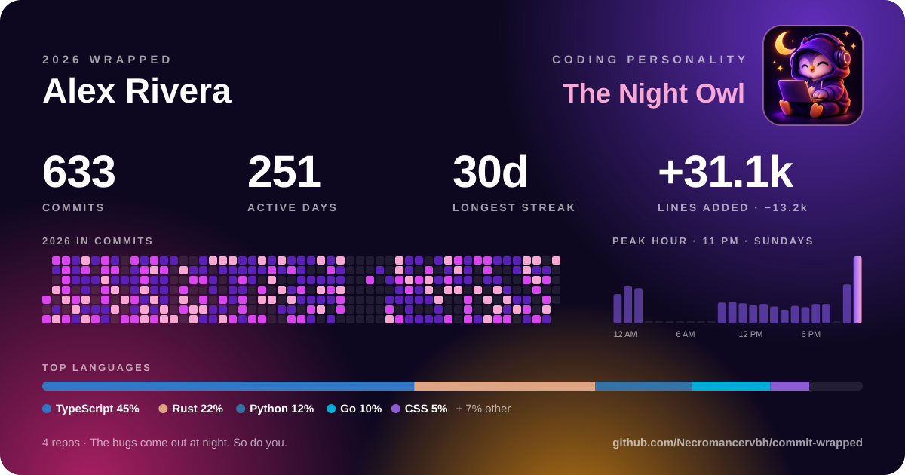
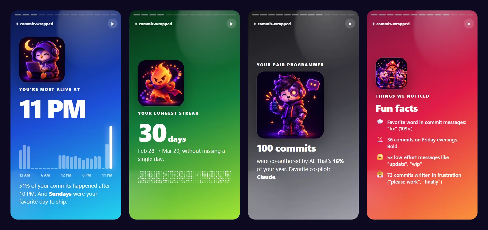

<div align="center">


**Spotify Wrapped for your git history.**

One command turns a year of commits into an animated story, a shareable card and a coding personality.
It works across every repo on your machine, has zero dependencies, and nothing ever leaves your laptop.

[](https://www.npmjs.com/package/commit-wrapped)
[](https://github.com/Necromancervbh/commit-wrapped/actions/workflows/ci.yml)


[](LICENSE)



### [▶ Watch a live demo story](https://necromancervbh.github.io/commit-wrapped/)

</div>

## Get yours in 10 seconds

```bash
npx commit-wrapped
```

Run it inside a repo, or point it at the folder where all your code lives to wrap your **whole year across every project**:

```bash
npx commit-wrapped ~/code
```

You get three things:

- 🎬 **An animated story** that opens in your browser, one slide at a time, just like the real Wrapped
- 🖼️ **A shareable card** (SVG or PNG) for X, LinkedIn, Slack, or your GitHub profile
- 🖥️ **A terminal summary** with a contribution heatmap, right where you ran it

<p align="center">
  
</p>

## What it finds out

| | |
| --- | --- |
| 📈 **The basics** | Commits, active days, lines added and deleted, longest streak |
| 🕰️ **Your rhythm** | Peak hour and weekday, using *your* local time when you committed |
| 🗓️ **Your year** | A GitHub-style contribution calendar, plus your single busiest day |
| 🌍 **Languages** | What you actually wrote, by lines changed |
| 📂 **Obsessions** | The files and repos you couldn't leave alone |
| 🤖 **AI pair programming** | How many commits were co-authored by Claude, Copilot, Cursor, Codex, Gemini and others |
| 💬 **Commit message forensics** | Your favorite word, your `wip` and `fix typo` count, and commits written in pure frustration ("please work") |
| 🚨 **Questionable choices** | Friday evening commits. We see you. |

## Which one are you?

Everyone gets a coding personality, picked from how they actually work:

| | Personality | You get it when... |
| --- | --- | --- |
|  | **🦉 The Night Owl** | 30%+ of your commits land between 10 PM and 5 AM |
|  | **🌅 The Early Bird** | You ship before 9 AM |
|  | **🔥 The Streak Machine** | You committed 21+ days in a row |
|  | **⚔️ The Weekend Warrior** | 35%+ of your commits happen on weekends |
|  | **🤖 The Cyborg** | Roughly 1 in 5 of your commits is co-authored by AI |
|  | **🧯 The Firefighter** | 30%+ of your commits are fixes |
|  | **🧹 The Marie Kondo** | You deleted more code than you wrote |
|  | **🏗️ The Architect** | Your average commit changes 250+ lines |
|  | **🎯 The Surgeon** | Across 100+ commits, your median one is a dozen lines or fewer |
|  | **🌍 The Polyglot** | Five or more languages make up a real share of your code |
|  | **⚡ The Sprinter** | You once made 30+ commits in a single day |
|  | **✈️ The Globetrotter** | You committed from 3+ time zones |
|  | **💼 The Professional** | About 80% of your commits are Monday to Friday, 9 to 6 |
|  | **📦 The Steady Shipper** | None of the above. Just reliable, drama-free shipping. |

Post yours and tag it **#commitwrapped**. Think we're missing one? [Add it](CONTRIBUTING.md), it's about ten lines of code.

## Put it on your GitHub profile

```bash
npx commit-wrapped ~/code --out .
```

Commit the generated `commit-wrapped-2026.svg` to your profile repo (`<you>/<you>`) and add this to its README:

```md

```

Prefer a light profile? Add `--theme paper`. Want hacker vibes? Use `--theme matrix`.

## Options

```text
commit-wrapped [paths...] [options]

  paths are git repos, or folders to search for repos (default: current directory)

  -y, --year <year>      Year to wrap (default: this year)
  -a, --author <text>    Count commits whose author name or email contains <text>.
                         Repeatable. Default: your git user.name and user.email
  -e, --everyone         Count every author (a team or project wrapped)
  -n, --name <name>      Name to show on the card
  -o, --out <dir>        Where to save the .html story, .svg card and .json (default: a temp folder)
  -t, --theme <theme>    Card theme: aurora, matrix, paper (default: aurora)
  -d, --depth <n>        How deep to search folders for repos (default: 3)
      --json             Print the raw stats as JSON
      --demo             Use sample data instead of your repos
      --no-open          Don't open the story in your browser
```

A few things to try:

```bash
npx commit-wrapped --everyone          # your team's year in the current repo
npx commit-wrapped -y 2025             # last year
npx commit-wrapped -a work@corp.com -a me@home.dev ~/code   # several emails
npx commit-wrapped --json | jq .personality                 # pipe it anywhere
```

## How it works

- **100% local.** It reads `git log` on your machine. No network calls, no tokens, no telemetry, and no dependencies to audit. Private repos, GitLab, Bitbucket and self-hosted are all fine.
- **Who counts as you:** commits whose author email or name matches your `git config user.email` or `user.name`. Use `--author` if you commit under several emails.
- **Which commits:** every branch, tag and remote-tracking branch, with merges skipped and duplicates across forks removed.
- **Time:** hours come from the commit's own timezone, so 11 PM in Tokyo counts as 11 PM even if you run this in London.
- **Lines:** lockfiles, minified bundles, `node_modules`, `vendor`, `dist` and single-file changes over 5,000 lines (almost always generated code) are ignored, so the numbers reflect real work.
- **AI co-authors** are read from `Co-authored-by:` trailers.

## FAQ

**It says "No commits by you".** Your commits probably use a different email than your current git config. Run `git log --format='%an <%ae>' | sort | uniq -c | sort -rn | head` to see who's who, then pass `--author <email>`.

**Can I share the story page?** Yes. It's a single self-contained HTML file. Keep in mind it includes file paths and commit messages. The card only has aggregate numbers.

**Does it work on Windows?** Yes, on Windows, macOS and Linux, with Node 18 or newer.

## Contributing

PRs for new personalities, themes, slides and languages are very welcome. See [CONTRIBUTING.md](CONTRIBUTING.md).

If commit-wrapped made you smile, **a ⭐ helps other developers find it.**

## License

[MIT](LICENSE). The banner, logo and character art were made for this project with AI image generation and are covered by the same license.
